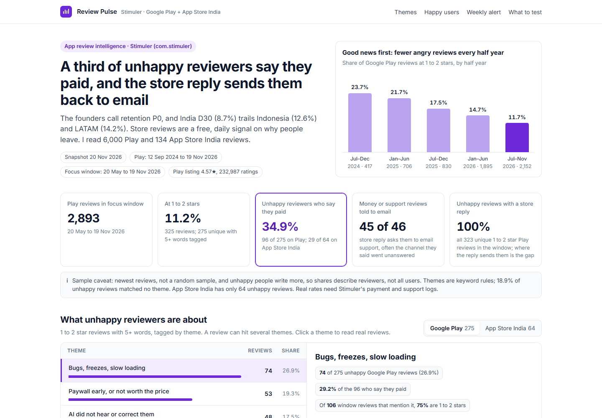

# stimuler-proof: what unhappy Stimuler reviewers say, and a weekly review alert



**Try it live:** https://stimuler-proof.vercel.app · **Code:** https://github.com/techi101/stimuler-proof

- **Problem:** Stimuler's founders call retention P0, and India D30 (8.7%) trails Indonesia (12.6%) and LATAM (14.2%) (Akshay Akash, Sep 2026). Store reviews are a free, daily signal on why people leave.
- **Result:** 96 of 275 unhappy Play reviewers (34.9%) say they paid, and 45 of the 46 store replies to "paid but no Pro" or "no reply" reviews ask the user to email support, often the channel the review says went unanswered.
- **Demo page:** open `web/index.html` in a browser (no install, no server), or run `python -m http.server -d web` and visit http://localhost:8000. Mobile view: [docs/screenshot_390.png](docs/screenshot_390.png). The full write-up is `REPORT.html` / `REPORT.pdf`.

Snapshot 20 Nov 2026. Public store reviews plus the founders' public posts. Review text is what users say, not verified account data.

## Data

| Source | What I pulled |
|---|---|
| Google Play com.stimuler (English, country India) | 6,000 newest reviews, 12 Sep 2024 to 19 Nov 2026. Listing: 4.57 stars, 232,987 ratings, 10M+ installs |
| Focus window: 20 May to 19 Nov 2026 | 2,893 reviews, 325 at 1 to 2 stars (11.2%); 275 unique texts with 5+ words tagged |
| App Store India (Apple RSS) | 134 newest written reviews, 9 Feb 2024 to 18 Nov 2026, 64 at 1 to 2 stars. Listing: 4.71 stars, 10,211 ratings |

Good news first: the 1 to 2 star share of Play reviews fell every half year, from 23.7% (Jul to Dec 2024, 417 reviews) to 11.7% (Jul to Nov 2026, 2,152 reviews).

## What the 275 unhappy Play reviews are about

A review can hit several themes.

| Theme | Reviews | Share |
|---|---|---|
| Bugs, freezes, slow loading | 74 | 26.9% |
| Paywall early, or not worth the price | 53 | 19.3% |
| AI did not hear or correct them | 48 | 17.5% |
| Support never replied | 36 | 13.1% |
| Content too basic or repetitive | 25 | 9.1% |
| Felt misled by ads or social media | 21 | 7.6% |
| Paid but Pro not active, or charged after cancelling | 17 | 6.2% |
| Asked for a refund | 16 | 5.8% |
| Stuck on the onboarding intro question | 5 | 1.8% |

18.9% matched no theme. Hand check of 10 random reviews per main theme: about 9 in 10 right for bugs, AI, support and payment; lower for the ad theme.

## Findings

1. **Paying users are a third of the angry reviews, and the store reply sends them back to email.** 96 of 275 (34.9%) say they paid; their top issues are bugs (29%), paywall or price (21%), no support reply (21%) and Pro not active (18%). On iOS, 29 of 64 unhappy reviews say they paid.
2. **Some ads set a "free" expectation the paywall breaks.** Four App Store India one star reviews name Instagram or social ads.
3. **Intermediate learners get bored, while happy users talk about confidence and jobs.** 25 complaints say lessons are too basic or repeat. In 992 happy reviews with 5+ words: speaking or fluency 97, confidence 28, interviews, jobs or IELTS 21.
4. **Free chatbots are the comparison.** ChatGPT, Gemini or Claude are named in 7 unhappy reviews, Duolingo in 8; none named ELSA, Praktika or Loora.

## What I would test

| # | Experiment | Measure |
|---|---|---|
| 1 | Paid user fast lane: "Restore my purchase" button that rechecks the store receipt, plus a 24 hour human reply for payers | Weekly "Pro not active" and refund reviews; refund requests |
| 2 | India ad and store copy that states the free limit up front, A/B against current creatives | Install to paid, D7, refund asks, 1 star share of new installs |
| 3 | 2 minute level check so intermediate users skip basics; creatives built on reviewers' words (confidence, interviews) | D7 of self rated intermediates; CTR of "confidence" vs "fluency" hooks |
| 4 | Fix the intro question 3 people got stuck on between 5 Oct and 10 Nov | Install to first lesson |

## Tool: weekly review alert

`alert.py` tags the last 7 days, compares each theme with the 4 weeks before, flags spikes (3+ reviews and 2x the usual week), and lists payers with money or support problems for a human to reach first. Sample output: `out/alert_week_2026-11-19.md`.

## Run it

```
pip install google-play-scraper pandas pytest
python fetch.py com.stimuler 6000 data/stimuler.csv          # Google Play reviews
python fetch_appstore.py 1627501632 in data/appstore_in.csv   # App Store India RSS
python analyze.py                                             # -> out/summary.json, out/quotes.json
python alert.py data/stimuler.csv --today 2026-11-19          # weekly alert
python -m pytest -q tests     # 13 tests
python web/export.py          # refresh the demo page data (web/data.json, web/data.js)
```

## Limits

- Newest reviews, not a random sample; unhappy people write more, so shares describe reviewers, not all users.
- The English Play feed also returns Spanish and Indonesian reviews (34 of the 275), so this is not India only.
- Themes are keyword rules (English, Hinglish, Spanish, Indonesian). Real rates need Stimuler's payment and support logs. The iOS sample is small.
